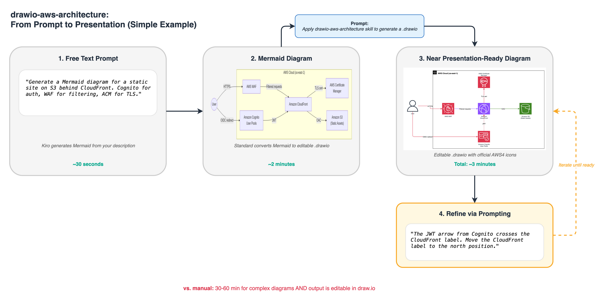
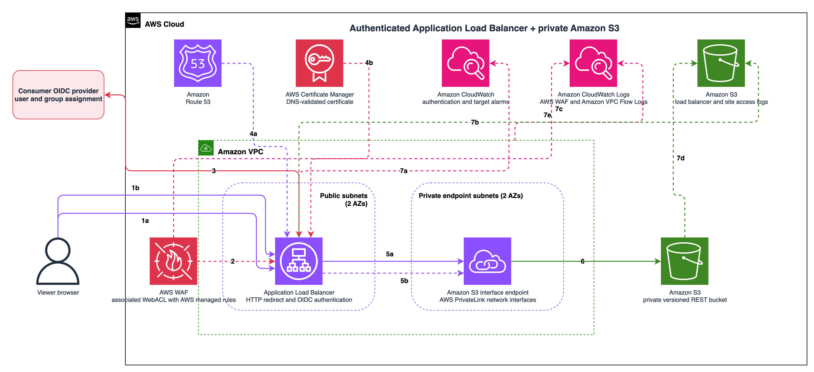

# Automated documentation and AWS architecture diagrams with Kiro and Sphinx

This repository generates and maintains project documentation and AWS
architecture diagrams from prompts, then hosts the result behind single sign-on
on AWS. [Kiro](https://kiro.dev/) writes [Sphinx](https://www.sphinx-doc.org/)
pages, and the bundled `drawio-aws-architecture` skill turns Mermaid
architecture descriptions into editable [draw.io](https://www.drawio.com/)
diagrams that use the official
[AWS Architecture Icons](https://aws.amazon.com/architecture/icons/).
[Terraform](https://developer.hashicorp.com/terraform) deploys a private
[Amazon S3](https://docs.aws.amazon.com/AmazonS3/latest/userguide/Welcome.html)
origin behind an internet-facing
[Application Load Balancer](https://docs.aws.amazon.com/elasticloadbalancing/latest/application/application-load-balancers.html)
that signs users in through your OpenID Connect (OIDC) identity provider.

This sample follows the user journey described below:

1. The author describes the system to Kiro. Kiro writes a Mermaid description
   and applies the skill to produce an editable `.drawio` diagram.
2. Kiro writes or updates the Sphinx pages that embed the diagram. `make html`
   exports the PNGs and builds the site, and automated checks validate the
   diagrams, the documentation, and the Terraform.
3. `make publish` uploads the site to the private bucket. Only users who sign
   in through your identity provider can read it.

Repository examples contain synthetic content only.

## Disclaimer

This sample is provided for demonstration and educational purposes only. It is
not intended for production use without a review against your own security,
operational, and compliance requirements. Deploying the Terraform in `infra/`
creates AWS resources that incur charges until you remove them.

## Architecture

### Documentation and diagram workflow



1. A free-text prompt describes the services, boundaries, and connections.
   Kiro writes them as Mermaid.
2. The `drawio-aws-architecture` skill looks up official service names, icons,
   and colors in its
   [icon reference](.kiro/skills/drawio-aws-architecture/reference/drawio-icon-reference.md),
   plans the layout, and writes the `.drawio` file.
3. `make html` exports a PNG for every changed `.drawio` source and builds the
   Sphinx site with warnings treated as errors.
4. Follow-up prompts refine the layout. Fixes go in the `.drawio` source,
   never in the PNG.

[`AGENTS.md`](AGENTS.md) tells Kiro how to maintain the documentation: where
pages go, which checks to run, and that any change under `infra/` must update
the Mermaid and draw.io sources in the same change. The Terraform is the source
of truth for the architecture.

### Hosting



1. An approved viewer connects to the internet-facing Application Load
   Balancer. HTTP requests are redirected to HTTPS.
2. An [AWS WAF](https://docs.aws.amazon.com/waf/latest/developerguide/waf-chapter.html)
   web ACL attached to the load balancer inspects each request with AWS managed
   rule groups.
3. The load balancer's
   [OIDC authentication action](https://docs.aws.amazon.com/elasticloadbalancing/latest/application/listener-authenticate-users.html)
   signs the viewer in through your identity provider.
4. [Amazon Route 53](https://docs.aws.amazon.com/Route53/latest/DeveloperGuide/Welcome.html)
   routes the hostname to the load balancer, and
   [AWS Certificate Manager](https://docs.aws.amazon.com/acm/latest/userguide/acm-overview.html)
   provides its TLS certificate.
5. After sign-in, the load balancer forwards the request to an Amazon S3
   [interface endpoint](https://docs.aws.amazon.com/AmazonS3/latest/userguide/privatelink-interface-endpoints.html),
   which reads the page from the private bucket through AWS PrivateLink.
6. Access logs, AWS WAF logs, Amazon VPC Flow Logs, and Amazon CloudWatch
   alarms record and monitor the traffic.

The [flow key](docs/hosting.md#flow-key) explains each numbered flow in the
diagram. The editable source is
[`docs/diagrams/authenticated-static-site.drawio`](docs/diagrams/authenticated-static-site.drawio).

### Networking & Security

- The site bucket is private. Block Public Access is on, versioning and
  server-side encryption with Amazon S3 managed keys are enabled, and the bucket
  policy allows reads only through the dedicated interface endpoint.
- No viewer source is allowed by default. You list approved IPv4 CIDR ranges or
  managed prefix lists, and Terraform opens viewer ingress only after the AWS
  WAF association and authenticated listener rules exist.
- Every HTTPS listener rule signs the viewer in before its final action,
  including the default 404 response.
- The interface endpoint lives in private subnets with no NAT gateway. It must
  be an interface endpoint, because an Application Load Balancer needs IP
  targets and a gateway endpoint has none.
- The HTTPS listener accepts TLS 1.2 or later only, and adds
  `Strict-Transport-Security`, `X-Content-Type-Options`, and `X-Frame-Options`
  headers to every response.
- AWS WAF logs redact query strings, authorization headers, and cookies.

See [authenticated hosting](docs/hosting.md) for the full architecture
reference.

### Design decisions

- **Application Load Balancer instead of Amazon CloudFront.** The load
  balancer's built-in OIDC action signs viewers in without custom
  authentication code. Amazon CloudFront would need a Lambda@Edge authorizer
  that you write and maintain. The trade-off is
  no edge caching and a fixed hourly cost, which suits internal documentation
  rather than high-traffic public sites.
- **Private REST bucket instead of website hosting.** Amazon S3 website
  endpoints serve HTTP only and require public read access. The REST endpoint,
  reached through the interface endpoint, keeps the bucket private.
- **Internet-facing load balancer with explicit viewer sources.** The load
  balancer must reach your identity provider's public endpoints, and viewers
  reach it over the internet, so it sits in public subnets. Network access is
  narrowed by the viewer sources you list, and every request still passes
  AWS WAF and sign-in.
- **No NAT gateway.** The private subnets only hold the interface endpoint,
  which needs no internet access.
- **Terraform as the source of truth.** `AGENTS.md` requires the diagrams and
  documentation to change with the Terraform, so they describe what is
  deployed.

### Restricting access to a VPN

To make the site reachable only from your corporate network, set the viewer
sources to your VPN egress ranges in `infra/terraform.tfvars`, either as CIDR
blocks or, preferably, as a managed prefix list that your network team
maintains:

```hcl
ingress_cidr_blocks     = []
ingress_prefix_list_ids = ["pl-0123456789abcdef0"]
```

Nothing else changes. Viewers off the VPN cannot connect to the load balancer,
and viewers on it still sign in through your identity provider. Your OIDC
endpoints must stay publicly reachable, because the load balancer calls them
over the internet.

## Prerequisites

### Amazon Web Services

- An active AWS account and an AWS Region for the deployment.
- A registered domain with a public Amazon Route 53 hosted zone in the same
  account.
  Terraform creates the certificate, its validation record, and the alias record.
- An OIDC application for the load balancer, with the callback URL
  `https://<domain>/oauth2/idpresponse`. Assign it only to the users or groups
  who should read the site. Its endpoints must use public HTTPS on port 443
  with a certificate from a CA that the load balancer trusts.
- One or more approved viewer IPv4 CIDR ranges or managed prefix lists.
- An encrypted, versioned, access-restricted remote state backend. Terraform
  state contains the OIDC client secret.

### Required software

- [Terraform](https://developer.hashicorp.com/terraform/install) 1.16, with the
  AWS provider 6.66.0 pinned in the deployment root:

  ```shell
  ❯ terraform --version
  Terraform v1.16.x
  ```

- [uv](https://docs.astral.sh/uv/) 0.10 or later. uv installs Python 3.11 or
  later and the locked documentation dependencies.
- [draw.io Desktop](https://github.com/jgraph/drawio-desktop/releases), for
  automated PNG export.
- [AWS CLI](https://docs.aws.amazon.com/cli/latest/userguide/getting-started-install.html),
  for publishing the site.
- [Kiro](https://kiro.dev/), to generate documentation and diagrams.
- `xmllint`, included with macOS and available in `libxml2-utils` on Linux.

`make check` needs both `xmllint` and draw.io Desktop. Without draw.io Desktop,
export PNGs manually from [app.diagrams.net](https://app.diagrams.net) and build
with `SKIP_DIAGRAMS=1`. Tested on macOS only; on Linux, put `drawio` on your
`PATH` or set `DRAWIO_BIN`.

## Deployment

This section explains how to build the site locally, deploy the hosting
infrastructure, and publish the site.

> **Warning:** Deploying the infrastructure creates AWS resources that incur
> charges until you remove them.

### Build and preview locally

No AWS credentials are needed for this step.

```shell
uv sync --locked
make html
make preview
```

Open `http://127.0.0.1:8000`. The preview listens on the local machine only.
Generated HTML is under `docs/_build/html/`.

To package a release archive with a SHA-256 checksum under `dist/`, named after
the current Git commit unless you set `VERSION`:

```shell
make release
make release VERSION=example
```

### Credentials

[Configure AWS CLI credentials](https://docs.aws.amazon.com/cli/latest/userguide/cli-configure-envvars.html),
then confirm the account and role:

```shell
aws sts get-caller-identity
```

### Infrastructure

Create the private configuration files and supply the OIDC client secret
outside source control:

```shell
cd infra
cp terraform.tfvars.example terraform.tfvars
cp backend.hcl.example backend.hcl
export TF_VAR_oidc_client_secret='<from your approved secret source>'
```

Replace every placeholder, then review and apply a saved plan:

```shell
terraform init -backend-config=backend.hcl
terraform plan -out=deploy.tfplan
terraform apply deploy.tfplan
```

Register the `oidc_callback_url` output with your OIDC application if you have
not already. See [`infra/README.md`](infra/README.md) for the full live
workflow.

### Publish the site

From the repository root:

```shell
make publish
```

This reads the bucket and Region from the Terraform outputs and runs
`aws s3 sync --delete`. Bucket versioning keeps earlier objects recoverable.
Without draw.io Desktop, run `make publish SKIP_DIAGRAMS=1` to use the
committed PNGs.

## Clean up

Load balancer deletion protection and bucket protection are on by default.
Turn them off in a reviewed plan, then destroy:

```shell
cd infra
terraform plan -var enable_deletion_protection=false -var force_destroy=true -out=unprotect.tfplan
terraform apply unprotect.tfplan
terraform plan -destroy -var enable_deletion_protection=false -var force_destroy=true -out=destroy.tfplan
terraform apply destroy.tfplan
```

The destroy deletes the site and log buckets, including all object versions.
See [teardown](docs/hosting.md#teardown) for what is retained and how to
redeploy.

## Testing

Run these checks before every change. None of them need AWS credentials.

```shell
make check      # diagram XML, labels and routing, lockfile, shell syntax, pytest
make html       # Sphinx build with warnings treated as errors
make tf-check   # Terraform format, validate, and mocked tests
```

A static security scan, such as
[Automated Security Helper (ASH)](https://github.com/awslabs/automated-security-helper),
covers the Terraform and Python code. Accepted findings are recorded in
[`.ash/.ash.yaml`](.ash/.ash.yaml) with a reason and an expiry date. To check
the locked Python dependencies for known vulnerabilities:

```shell
uv export --frozen --all-groups --no-emit-project --no-hashes -o requirements-audit.txt
uvx --from pip-audit==2.9.0 pip-audit -r requirements-audit.txt --no-deps --disable-pip
rm requirements-audit.txt
```

## Next steps

### Forking for your team

1. Replace the pages in `docs/` and update `docs/conf.py`.
2. Replace the placeholder package in `src/my_awesome_machine_learning_package/`
   with your own code, and point `docs/api.rst` at your modules.
3. Ask Kiro to update the documentation and diagrams as your system changes,
   then run the checks and `make publish`.

### Repository layout

```text
AGENTS.md                                 Agent instructions for maintaining the docs
docs/                                     Sphinx sources and draw.io diagrams
src/my_awesome_machine_learning_package/  Placeholder package rendered by autodoc
infra/                                    Terraform deployment root
  modules/networking/                     VPC and flow logs (terraform-aws-modules/vpc)
  modules/authenticated-static-site/      ALB, OIDC, S3 interface endpoint, private S3
scripts/                                  Build, release, preview, and publish helpers
tests/                                    Documentation, diagram, and package tests
.kiro/skills/drawio-aws-architecture/     Diagram-generation skill and references
```

See [getting started](docs/getting-started.md),
[authenticated hosting](docs/hosting.md),
[Python API reference](docs/api.rst), and
[generating architecture diagrams](docs/diagram-generation.md).

## Dependencies and Licenses

This project is licensed under the MIT-0 License. See the [LICENSE](LICENSE)
file for details. Third-party notices for redistributed components, including
the vendored Mermaid bundle, are in [THIRD-PARTY-LICENSES](THIRD-PARTY-LICENSES).

### Dependencies

- [Sphinx](https://www.sphinx-doc.org/) 8.2.3
- [MyST Parser](https://myst-parser.readthedocs.io/) 5.1.0
- [PyData Sphinx Theme](https://pydata-sphinx-theme.readthedocs.io/) 0.22.0
- [sphinxcontrib-mermaid](https://github.com/mgaitan/sphinxcontrib-mermaid) 2.1.1
- [Terraform AWS Provider](https://registry.terraform.io/providers/hashicorp/aws/6.66.0) 6.66.0
- [terraform-aws-modules/vpc](https://registry.terraform.io/modules/terraform-aws-modules/vpc/aws/6.7.3) 6.7.3
- [Terraform](https://developer.hashicorp.com/terraform) 1.16
- [draw.io Desktop](https://github.com/jgraph/drawio-desktop)

The hosting pattern is based on
[Hosting internal HTTPS static websites with ALB, S3, and PrivateLink](https://aws.amazon.com/blogs/networking-and-content-delivery/hosting-internal-https-static-websites-with-alb-s3-and-privatelink/).

## Security

See [CONTRIBUTING](CONTRIBUTING.md#security-issue-notifications) for more
information.

## License

This library is licensed under the MIT-0 License. See the [LICENSE](LICENSE)
file.
